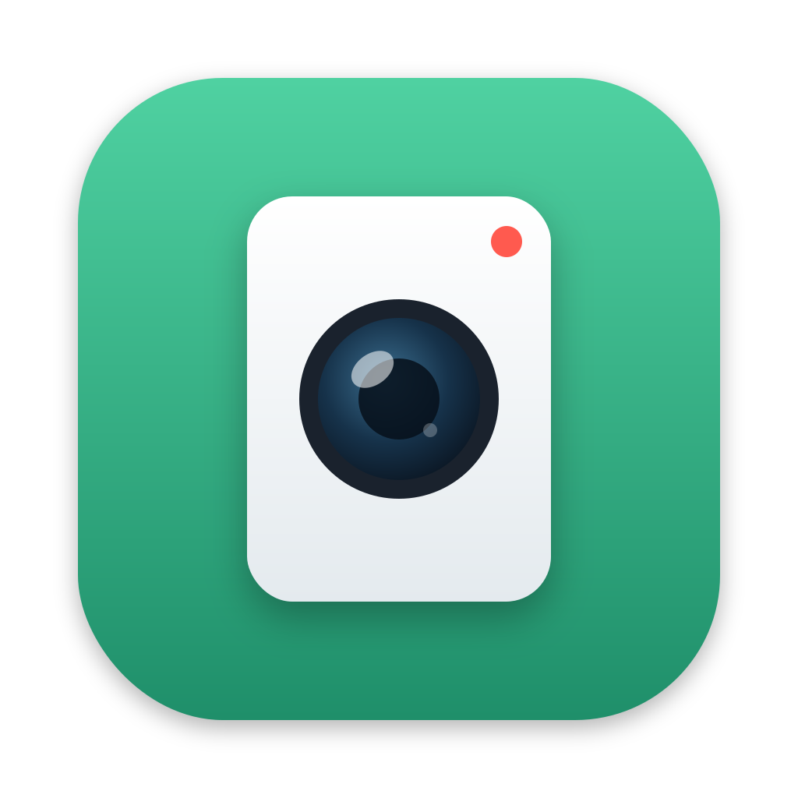
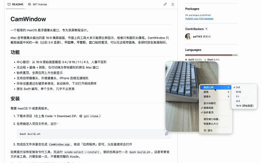

<p align="center"></p>

# CamWindow

一个极简的 macOS 悬浮摄像头窗口，专为录屏教程设计。

Mac 自带摄像头输出的是 16:9 横屏画面，市面上的工具大多只能原比例显示，或者只有圆形头像框。CamWindow 只截取画面中间的一块（比如 3:4 竖屏），**不拉伸、不变形**，窗口始终置顶，可以无边框带圆角，录屏时放在角落刚好。

<p align="center"></p>

## 功能

- 中心裁切：从 16:9 原始画面截取 3:4 / 9:16 / 1:1 / 4:3，人像不变形
- 无边框 + 圆角 + 阴影，也可切换为带标题栏的原生 Mac 窗口
- 始终置顶，全屏应用上方也能显示
- 支持自带摄像头、外接摄像头、iPhone 连续互通相机
- 所有设置通过右键菜单修改，自动保存，下次打开保持原样
- 原生 Swift 编写，单个文件，几乎不占资源

## 安装

需要 macOS 11 或更高版本。

1. 下载本项目（右上角 Code → Download ZIP，或 `git clone`）
2. 在终端进入项目文件夹，运行：

   ```bash
   bash build.sh
   ```

3. 完成后文件夹里会生成 `CamWindow.app`，拖进「应用程序」即可，以后直接双击打开

如果提示没有安装命令行工具，先运行 `xcode-select --install`，装好后再运行一次 `bash build.sh`。这是苹果官方开发工具，只需安装一次，不需要完整的 Xcode。

第一次打开时系统会请求摄像头权限，点「允许」即可。

## 使用

| 操作 | 方式 |
| --- | --- |
| 移动窗口 | 按住画面任意位置拖动 |
| 缩放窗口 | 在画面上滚动鼠标滚轮，或触控板双指上下滑 |
| 打开设置 | 右键点击画面 |
| 退出 | 右键 → 退出，或按 Esc / ⌘Q |

右键菜单可以设置：画面比例、圆角大小、摄像头、显示标题栏、镜像画面、始终置顶、窗口标题、恢复默认大小。

## 常见问题

**画面是黑的？**
到「系统设置 → 隐私与安全性 → 摄像头」，确认 CamWindow 已打开。

**为什么不直接提供 .app 下载？**
没有苹果开发者签名的 App 下载后会被系统拦截。本地编译生成的 App 不受影响，所以采用 `build.sh` 一键编译的方式，全程只需一行命令。

**圆角选项是灰色的？**
圆角只在无边框模式下生效，先在右键菜单里取消「显示标题栏」。

## License

MIT
